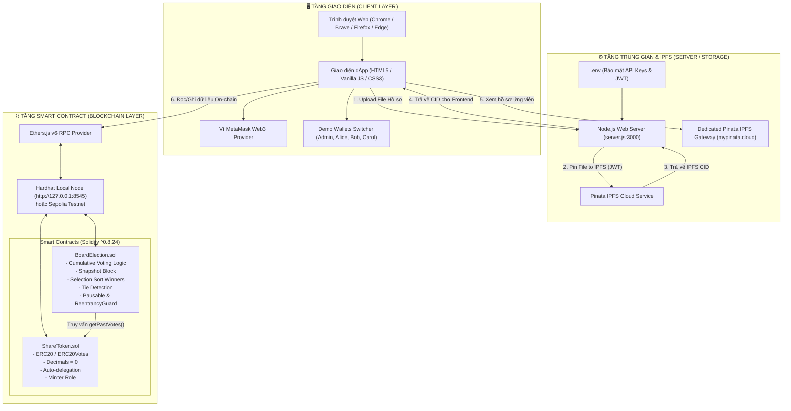
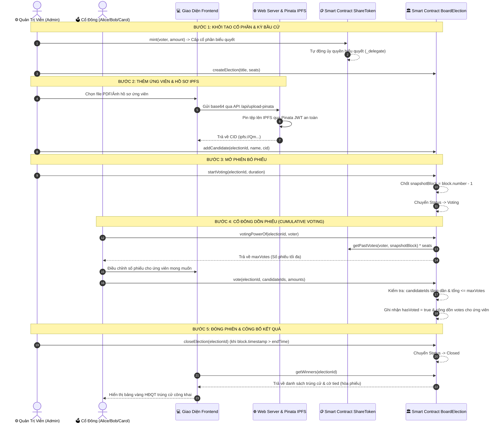
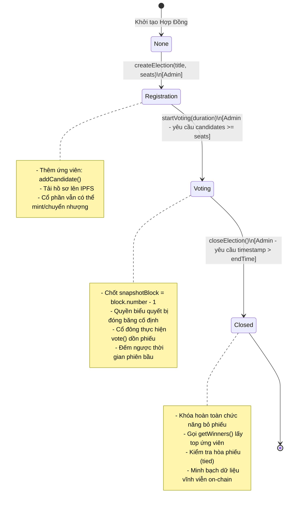
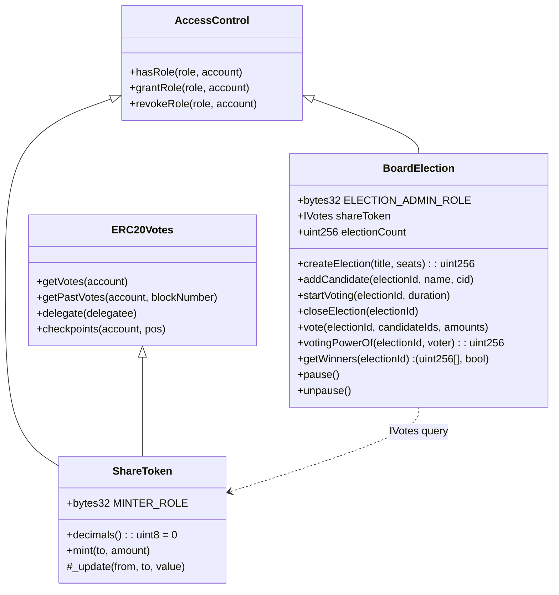

# 🏛️ HỆ THỐNG BỎ PHIẾU BẦU HỘI ĐỒNG QUẢN TRỊ (ON-CHAIN CUMULATIVE VOTING)

> **Hệ thống bỏ phiếu bầu Hội đồng Quản trị (HĐQT) theo phương thức Bầu dồn phiếu (Cumulative Voting) trên nền tảng Blockchain Ethereum, kết hợp lưu trữ phi tập trung IPFS (Pinata Cloud) và giao diện Web dApp tương tác đa vai trò.**

---

## 📌 MỤC LỤC
1. [Giới thiệu tổng quan](#1-giới-thiệu-tổng-quan)
2. [Nguyên lý hoạt động & Bầu dồn phiếu](#2-nguyên-lý-hoạt-động--cơ-chế-bầu-dồn-phiếu)
3. [Sơ đồ hệ thống](#3-sơ-đồ-hệ-thống)
   - [Sơ đồ kiến trúc tổng thể (Architecture)](#sơ-đồ-kiến-trúc-tổng-thể)
   - [Sơ đồ luồng quy trình nghiệp vụ (Sequence Diagram)](#sơ-đồ-luồng-quy-trình-nghiệp-vụ)
   - [Sơ đồ máy trạng thái cuộc bầu cử (State Diagram)](#sơ-đồ-máy-trạng-thái-cuộc-bầu-cử)
   - [Sơ đồ cấu trúc Smart Contract & Phân quyền](#sơ-đồ-cấu-trúc-smart-contract--phân-quyền)
4. [Các tính năng nổi bật](#4-các-tính-năng-nổi-bật)
5. [Cấu trúc thư mục dự án](#5-cấu-trúc-thư-mục-dự-án)
6. [Yêu cầu môi trường (Prerequisites)](#6-yêu-cầu-môi-trường)
7. [Hướng dẫn cài đặt & Khởi chạy từng bước](#7-hướng-dẫn-cài-đặt--khởi-chạy-từng-bước)
8. [Hướng dẫn trải nghiệm kịch bản mẫu](#8-hướng-dẫn-trải-nghiệm-kịch-bản-mẫu)
9. [Triển khai lên mạng Testnet (Sepolia)](#9-triển-khai-lên-mạng-testnet-sepolia)
10. [Kiểm thử tự động (Unit Testing)](#10-kiểm-thử-tự-động-unit-testing)
11. [Chính sách bảo mật & Quản lý API Key / Secrets](#11-chính-sách-bảo-mật--quản-lý-api-key--secrets)

---

## 1. Giới thiệu tổng quan

Trong các công ty cổ phần, việc bầu thành viên **Hội đồng Quản trị (HĐQT)** là một trong những quyết định quan trọng nhất của Đại hội đồng Cổ đông. Tuy nhiên, các phương thức bầu cử truyền thống (bỏ phiếu giấy hoặc phần mềm tập trung) tiềm ẩn nhiều nhược điểm:
- **Thiếu minh bạch**: Khó kiểm chứng việc kiểm phiếu độc lập.
- **Dễ gian lận**: Nguy cơ sửa đổi kết quả hoặc lộ thông tin bỏ phiếu trước giờ G.
- **Chèn ép cổ đông thiểu số**: Cổ đông lớn nắm trên 51% cổ phần có thể thâu tóm toàn bộ ghế HĐQT nếu áp dụng phương thức bầu đa số thông thường.

Dự án **Hệ Thống Bỏ Phiếu Bầu HĐQT On-chain** giải quyết triệt để các bài toán trên bằng cách:
1. **Ứng dụng Smart Contract Ethereum**: Thực hiện cơ chế **Bầu dồn phiếu (Cumulative Voting)** chuẩn hóa theo **Điều 148 Luật Doanh nghiệp 2020 (Việt Nam)**.
2. **Snapshot quyền biểu quyết lịch sử**: Sử dụng OpenZeppelin `ERC20Votes` với checkpoint theo số khối (block number), loại bỏ triệt để rủi ro tấn công vay nhanh (flash loan attack) hoặc gom mua cổ phần tạm thời để thao túng.
3. **Lưu trữ phi tập trung IPFS (Pinata Cloud)**: Hồ sơ lý lịch và bằng cấp của ứng viên được băm CID và lưu trên IPFS, ngăn chặn việc sửa đổi hồ sơ sau khi đã phê duyệt.
4. **Trực quan hóa & Phân quyền (RBAC)**: Giao diện Web dApp trực quan phục vụ 3 nhóm đối tượng: Quản trị viên (Admin), Cổ đông (Voter), và Công chúng (Guest).

---

## 2. Nguyên lý hoạt động & Cơ chế Bầu dồn phiếu

### 2.1. Công thức toán học
Theo luật doanh nghiệp, mỗi cổ đông có quyền nhân số cổ phần sở hữu với số ghế HĐQT cần bầu:

$$\text{Tổng số phiếu biểu quyết} = \text{Số cổ phần sở hữu tại Snapshot} \times \text{Số ghế HĐQT cần bầu}$$

**Ví dụ:**
- Cổ đông Alice sở hữu **60 cổ phần**.
- Cuộc bầu cử cần bầu **3 ghế HĐQT**.
- Tổng số phiếu Alice có: $60 \times 3 = 180 \text{ phiếu}$.

### 2.2. Chiến lược phân bổ phiếu linh hoạt
Alice có toàn quyền:
- Dồn toàn bộ **180 phiếu** cho 1 ứng viên duy nhất mà mình tin tưởng; HOẶC
- Chia đều hoặc phân bổ bất kỳ: 100 phiếu cho ứng viên A, 50 phiếu cho B, 30 phiếu cho C ($\sum \le 180$).

Nhờ cơ chế này, các **cổ đông thiểu số** (ví dụ liên minh Bob 25 CP và Carol 35 CP) có thể tập trung dồn phiếu vào 1 ứng viên để chắc chắn đưa được đại diện của mình vào HĐQT.

### 2.3. Các cơ chế bảo vệ On-chain
- **Chống bỏ phiếu lặp lại (Double-Voting Guard)**: Lưu trữ trạng thái `hasVoted[voter] = true` theo mô hình *Checks-Effects-Interactions*.
- **Chống trùng lặp ứng viên trong mảng**: Bắt buộc mảng `candidateIds` truyền vào phải tăng dần nghiêm ngặt ($id_0 < id_1 < \dots$).
- **Snapshot quá khứ**: Lấy quyền biểu quyết tại $Block_{\text{snapshot}} = Block_{\text{hiện tại}} - 1$ để tránh việc giao dịch token trong cùng block nhằm nhân bản số phiếu.
- **Kiểm tra đồng phiếu (Tie Detection)**: Thuật toán sắp xếp tự động phát hiện nếu ứng viên ở vị trí trúng cử cuối cùng bằng số phiếu với ứng viên kế tiếp, kích hoạt cờ cảnh báo `tied = true`.

---

## 3. Sơ đồ hệ thống

### Sơ đồ kiến trúc tổng thể



---

### Sơ đồ luồng quy trình nghiệp vụ



---

### Sơ đồ máy trạng thái cuộc bầu cử



---

### Sơ đồ cấu trúc Smart Contract & Phân quyền



---

## 4. Các tính năng nổi bật

| Nhóm chức năng | Chi tiết tính năng |
| :--- | :--- |
| **Bầu dồn phiếu** | Cho phép cổ đông phân bổ toàn quyền số phiếu cho 1 hoặc nhiều người; tự động tính tổng số phiếu còn lại; chặn vượt ngưỡng biểu quyết. |
| **Phân quyền 3 vai trò** | - **Admin**: Quản lý kỳ bầu, thêm ứng viên, mint cổ phần, mở/đóng phiên, tạm dừng khẩn cấp.<br>- **Voter**: Xem quyền biểu quyết cá nhân, bỏ phiếu, tra cứu biên lai giao dịch.<br>- **Guest**: Xem công khai tiến độ, danh sách ứng viên và kết quả on-chain. |
| **Hồ sơ phi tập trung IPFS** | Tích hợp tải file trực tiếp lên IPFS qua Pinata Gateway riêng. Người tham gia có thể nhấp xem trực tiếp lý lịch trích ngang của ứng viên. |
| **Snapshot Checkpoint** | Sử dụng `getPastVotes` của `ERC20Votes` đảm bảo cổ phần mua sau thời điểm snapshot không có hiệu lực biểu quyết cho kỳ đó. |
| **Giải quyết Hòa phiếu (Tie)** | Tự động phát hiện trường hợp đồng số phiếu ở vị trí ghế cuối cùng để thông báo triệu tập biểu quyết lại theo quy chế công ty. |
| **Đăng nhập linh hoạt** | Hỗ trợ song song cả **MetaMask** (mạng thực tế) và bộ **Ví Giả lập Nhanh (Admin, Alice, Bob, Carol)** giúp người đánh giá thử nghiệm nhanh mà không cần cài extension. |

---

## 5. Cấu trúc thư mục dự án

```text
Blockchain/
├── .gitignore                      # Bộ quy tắc chặn lọt API key & secrets ở thư mục gốc
├── .ignore                         # Bản sao alias quy chuẩn chống lộ file nhạy cảm
├── .env.example                    # File mẫu hướng dẫn thiết lập biến môi trường
├── README.md                       # Tài liệu hướng dẫn toàn diện của dự án
└── He_Thong_Bau_HDQT/              # Thư mục mã nguồn chính của ứng dụng
    ├── contracts/                  # Thư mục Smart Contracts (Solidity)
    │   ├── BoardElection.sol       # Hợp đồng bầu cử dồn phiếu
    │   ├── ShareToken.sol          # Hợp đồng token cổ phần ERC20Votes
    │   └── mocks/                  # Hợp đồng giả lập phục vụ kiểm thử
    ├── scripts/                    # Scripts triển khai & cấu hình
    │   ├── deploy-local.js         # Script deploy lên local node & tạo dữ liệu mẫu
    │   ├── deploy-localhost.ts     # Script TypeScript deploy tương thích Hardhat
    │   └── demo.ts                 # Kịch bản demo bỏ phiếu mẫu trên terminal
    ├── frontend/                   # Ứng dụng Web dApp Client & Server
    │   ├── index.html              # Giao diện chính (3 phân hệ: Admin/Voter/Guest)
    │   ├── app.js                  # Logic Web3 kết nối Smart Contract, IPFS & MetaMask
    │   ├── style.css               # Phong cách giao diện hiện đại, chuyên nghiệp
    │   ├── server.js               # Web server HTTP tích hợp API Upload Pinata IPFS
    │   ├── config.js               # Cấu hình địa chỉ contract & ABI (tự sinh sau deploy)
    │   └── ethers.umd.min.js       # Thư viện Ethers.js v6 đóng gói sẵn
    ├── test/                       # Bộ kiểm thử tự động (Unit Tests)
    │   └── BoardElection.test.ts   # 20+ ca kiểm thử bảo mật & logic bầu cử
    ├── hardhat.config.ts           # Cấu hình mạng Hardhat (Local & Sepolia)
    ├── package.json                # Dependencies & lệnh npm chạy dự án
    ├── .gitignore                  # Gitignore riêng của thư mục dự án
    └── .env.example                # Mẫu biến môi trường cục bộ
```

---

## 6. Yêu cầu môi trường

Trước khi cài đặt, hãy đảm bảo máy tính đã cài:
- **Node.js**: Phiên bản `>= 18.0.0` (Khuyên dùng `v20.x` hoặc `v22.x LTS`).
- **npm**: Đi kèm theo Node.js (hoặc `pnpm` / `yarn`).
- **Git**: Dùng để quản lý mã nguồn.
- **Trình duyệt**: Google Chrome, Brave, Microsoft Edge,... (Cài sẵn extension **MetaMask** nếu muốn thử nghiệm ký giao dịch thực tế).

---

## 7. Hướng dẫn cài đặt & Khởi chạy từng bước

### Bước 1: Điều hướng vào thư mục dự án & Cài đặt thư viện

Mở terminal tại thư mục gốc của dự án:

```bash
# Di chuyển vào thư mục ứng dụng
cd He_Thong_Bau_HDQT

# Cài đặt các gói thư viện
npm install
```

---

### Bước 2: Thiết lập file môi trường `.env`

Tạo file `.env` từ file mẫu `.env.example`:

```bash
# Trên Windows PowerShell:
Copy-Item .env.example .env

# Trên Linux / macOS:
cp .env.example .env
```

Mở file `.env` và kiểm tra cấu hình:
- `PORT=3000`
- `PINATA_JWT=...` (Hệ thống đã có sẵn cấu hình mặc định để tải hồ sơ lên Pinata IPFS, hoặc bạn có thể điền JWT từ tài khoản Pinata cá nhân của mình).
- `PINATA_GATEWAY=...`

---

### Bước 3: Khởi động Blockchain Local Node

Mở một cửa sổ Terminal riêng (Terminal 1) và chạy lệnh:

```bash
npx hardhat node
```

> **Kết quả:** Terminal sẽ hiển thị mạng Ethereum giả lập lắng nghe tại `http://127.0.0.1:8545` kèm theo danh sách 20 tài khoản có sẵn 10,000 ETH test. **Giữ nguyên terminal này chạy ngầm.**

---

### Bước 4: Biên dịch & Triển khai Smart Contract

Mở một cửa sổ Terminal thứ 2 (Terminal 2) tại thư mục `He_Thong_Bau_HDQT` và thực thi:

```bash
node scripts/deploy-local.js
```

**Script trên sẽ tự động hoàn tất:**
1. Biên dịch các file `.sol` trong `contracts/`.
2. Triển khai `ShareToken.sol` lên mạng Local.
3. Triển khai `BoardElection.sol` liên kết với `ShareToken`.
4. Cấp phát cổ phần mẫu:
   - **Alice**: 60 cổ phần (50.0%)
   - **Bob**: 25 cổ phần (20.8%)
   - **Carol**: 35 cổ phần (29.2%)
5. Tạo sẵn kỳ bầu cử mẫu số `#1`: *"Đại hội Cổ đông 2027 - Bầu HĐQT Doanh nghiệp"* với **3 ghế HĐQT** và **5 ứng viên mẫu**.
6. Tự động xuất thông tin địa chỉ contract và ABI ra file `frontend/config.js`.

---

### Bước 5: Khởi động Web Server & dApp

Vẫn tại Terminal 2, chạy lệnh khởi động server dApp:

```bash
node frontend/server.js
```

> Hoặc dùng lệnh tắt đã cấu hình trong package.json: `npm run serve`

Terminal sẽ hiển thị thông báo:
```text
============================================================
🌐 WEB SERVER ĐÃ SẴN SÀNG TẠI: http://127.0.0.1:3000
📡 Đã tích hợp IPFS Pinata Gateway
👉 Mở trình duyệt và truy cập: http://localhost:3000
============================================================
```

---

### Bước 6: Truy cập giao diện Web

Mở trình duyệt và truy cập vào:
👉 **[http://localhost:3000](http://localhost:3000)**

---

## 8. Hướng dẫn trải nghiệm kịch bản mẫu

Trên trang đăng nhập `http://localhost:3000`, bạn có thể lựa chọn đăng nhập bằng 2 hình thức:
1. **Kết Nối Ví MetaMask**: Dành cho môi trường thực tế (chuyển mạng MetaMask sang Localhost 8545 - Chain ID 31337).
2. **Đăng Nhập Nhanh (Demo Accounts)**: Nhấp trực tiếp vào một trong các thẻ tài khoản đã được chuẩn bị sẵn:

### Kịch bản thử nghiệm hoàn chỉnh:

1. **Đăng nhập với tư cách Quản trị viên (Admin)**:
   - Nhấp vào **"Đăng Nhập Ví Admin"**.
   - Tại tab **"⚙️ Quản Trị Cuộc Bầu Cử"**: Bạn sẽ thấy kỳ bầu cử số `#1` đang ở trạng thái **Sắp diễn ra (Registration)**.
   - Thử thêm một ứng viên mới: Nhập tên ứng viên, chọn một file PDF hoặc ảnh hồ sơ từ máy tính $\rightarrow$ Nhấn **"Thêm Ứng Viên"** (Hệ thống sẽ tải hồ sơ lên Pinata IPFS và lưu CID vào Blockchain).
   - Thiết lập thời gian bầu cử (ví dụ: `3600` giây) và nhấn **"Mở Phiên Bỏ Phiếu"**.
   - Trạng thái kỳ bầu cử lập tức chuyển sang **Đang diễn ra (Voting)** kèm đồng hồ đếm ngược.

2. **Chuyển sang Cổ đông Alice (Nắm 50% cổ phần)**:
   - Nhấn **"Đổi Tài Khoản / Đăng Xuất"** ở góc trên bên phải.
   - Chọn **"Cổ đông Alice"** (Sở hữu 60 CP $\times$ 3 ghế = **180 phiếu bầu**).
   - Tại tab **"🗳️ Bỏ Phiếu"**: Hệ thống hiển thị số phiếu tối đa là 180.
   - Thử nghiệm dồn phiếu:
     - Ứng viên Nguyễn Văn An: 120 phiếu
     - Ứng viên Trần Thị Bình: 60 phiếu
   - Nhấn **"Xác Nhận Ký Gửi Phiếu Bầu Lên Blockchain"**.
   - Sau khi giao dịch hoàn tất, số phiếu còn lại của Alice trở về 0 và trạng thái ghi nhận "Đã hoàn thành bỏ phiếu".

3. **Chuyển sang Cổ đông Bob (Nắm 20.8% - 75 phiếu)**:
   - Đăng nhập ví Bob.
   - Thử nghiệm chiến lược bảo vệ cổ đông nhỏ: Bob dồn toàn bộ **75 phiếu** cho ứng viên Lê Văn Cường.
   - Gửi giao dịch bỏ phiếu.

4. **Đóng phiên & Kiểm tra kết quả trúng cử**:
   - Đăng nhập lại ví **Admin**.
   - Nhấn **"Đóng Phiên Bầu Cử"**.
   - Chuyển sang tab **"📊 Kết Quả & Giám Sát"**:
     - Hệ thống tự động gọi hàm `getWinners()` từ Smart Contract.
     - Hiển thị danh sách **3 ứng viên có số phiếu cao nhất trúng cử vào HĐQT**.
     - Biểu đồ phân bổ phiếu bầu minh bạch và thông tin chi tiết từng ứng viên.

5. **Đăng nhập với tư cách Khách (Guest)**:
   - Đăng xuất và chọn **"Đăng Nhập Với Tư Cách Khách"**.
   - Bất kỳ ai trong công chúng cũng có thể tra cứu toàn bộ lịch sử các cuộc bầu cử, kiểm tra hồ sơ ứng viên trên IPFS và xác thực kết quả on-chain mà không cần tài khoản hay ví Web3.

---

## 9. Triển khai lên mạng Testnet (Sepolia)

Nếu muốn đưa hệ thống lên mạng thử nghiệm công khai Ethereum Sepolia:

1. **Lấy RPC URL và Private Key có Sepolia ETH**:
   - Đăng ký tài khoản tại [Alchemy](https://www.alchemy.com/) hoặc [Infura](https://www.infura.io/) để lấy RPC Endpoint.
   - Nhận Sepolia ETH miễn phí từ các vòi (Faucet): [sepoliafaucet.com](https://sepoliafaucet.com/).

2. **Điền thông tin vào `.env`**:
   ```env
   SEPOLIA_RPC_URL=https://eth-sepolia.g.alchemy.com/v2/YOUR_API_KEY
   SEPOLIA_PRIVATE_KEY=your_private_key_without_0x
   ```

3. **Chạy lệnh triển khai**:
   ```bash
   npx hardhat run scripts/deploy.ts --network sepolia
   ```

---

## 10. Kiểm thử tự động (Unit Testing)

Dự án đi kèm bộ kiểm thử tự động toàn diện được viết bằng **Mocha, Chai và Ethers.js** tại `test/BoardElection.test.ts`.

Để chạy toàn bộ kiểm thử:
```bash
npx hardhat test
```

### Các kịch bản kiểm thử trọng tâm:
- **TC01 - TC03**: Kiểm tra thuộc tính `decimals = 0`, phân quyền `MINTER_ROLE`, và tự động ủy quyền biểu quyết (`auto-delegation`) của `ShareToken`.
- **TC04 - TC06**: Kiểm tra quyền tạo kỳ bầu cử, chặn khởi tạo số ghế $\le 0$, phân quyền `ELECTION_ADMIN_ROLE`.
- **TC07 - TC08**: Thêm ứng viên hợp lệ, chặn thêm ứng viên khi đã quá số lượng tối đa `MAX_CANDIDATES` (chống DoS gas).
- **TC09 - TC11**: Cơ chế snapshot block, chặn mở phiên khi số ứng viên ít hơn số ghế cần bầu.
- **TC12 - TC15**: Tính toán chính xác quyền biểu quyết theo công thức $CP \times Ghế$; chặn bỏ phiếu vượt số quyền biểu quyết cho phép; chặn bỏ phiếu hai lần (Double voting).
- **TC16**: Bắt buộc mảng `candidateIds` phải tăng dần nghiêm ngặt (chống gian lận lặp ID để dồn nhiều lần).
- **TC17 - TC18**: Xác định danh sách trúng cử chính xác bằng thuật toán sắp xếp on-chain; phát hiện trường hợp đồng phiếu tại vị trí ghế cuối cùng (`tied = true`).
- **TC19 - TC20**: Kiểm tra cơ chế khẩn cấp `pause()` và `unpause()` của Quản trị viên.

---

## 11. Chính sách bảo mật & Quản lý API Key / Secrets

Để đảm bảo an toàn tuyệt đối cho dự án và tránh bị lộ các thông tin nhạy cảm lên GitHub/GitLab:

### 11.1. Tệp `.gitignore` và `.ignore`
Dự án đã cấu hình sẵn cả hai file `.gitignore` và `.ignore` ở cả thư mục gốc và thư mục con:
- **Tuyệt đối không commit**:
  - Tệp `.env`, `.env.*`, `.env.local`
  - Các chứng chỉ số, private keys: `*.pem`, `*.key`, `*.p12`, `*.pfx`, `*.keystore`
  - Khóa API / Token dịch vụ: `PINATA_JWT`, Infura / Alchemy API Keys
  - Thư mục phụ thuộc: `node_modules/`
  - Thư mục biên dịch: `artifacts/`, `cache/`, `types/`
  - File tạm của hệ điều hành và IDE: `.vscode/`, `.idea/`, `.DS_Store`, `Thumbs.db`

### 11.2. Nguyên tắc chia sẻ mã nguồn an toàn
1. **Chỉ commit file mẫu `.env.example`**: Tệp này chỉ chứa tên biến và giá trị giữ chỗ (placeholder), không chứa bất kỳ mã bí mật thực tế nào.
2. **Backend Proxy cho IPFS**: Các cuộc gọi nhạy cảm đến dịch vụ Pinata IPFS được xử lý hoàn toàn qua backend proxy (`frontend/server.js`), không bao giờ để lộ JWT Secret Token ra phía client trình duyệt.
3. **Kiểm tra trước khi commit**: Luôn chạy lệnh `git status` trước khi commit để chắc chắn không có file nhạy cảm nào lọt vào staging area.

---

## 👨‍💻 Tác giả & Giấy phép
- Dự án phục vụ mục đích nghiên cứu, học tập và ứng dụng công nghệ Blockchain trong quản trị doanh nghiệp.
- Giấy phép mã nguồn: **MIT License**.
